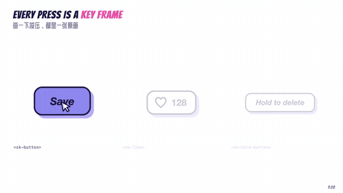

<div align="center">

<a href="docs/media/promo.mp4"></a>

<p><b>Every press is a key frame.</b><br>
Web components with anime key-animation energy: cel-style effects, katakana lettering and synthesised sound, sharing one small core.</p>

<p>
<a href="https://github.com/LeeHongji/sakuga-ui/blob/main/LICENSE"></a>
<a href="https://www.npmjs.com/package/sakuga-ui"></a>


</p>

<p>
<a href="https://leehongji.github.io/sakuga-ui/"><b>Docs</b></a> ·
<a href="docs/media/promo.mp4"><b>Promo film (with sound)</b></a> ·
<a href="#quick-start"><b>Quick start</b></a> ·
<a href="README.md"><b>中文</b></a>
</p>

</div>

---

## Episode 0 · A first look

<table>
<tr>
<td width="50%"><br><b>Presses are key frames.</b> Buttons squash and spring back, likes burst, and the hold button only slashes open with ザンッ! once it is fully charged.</td>
<td width="50%"><br><b>Lettering built in.</b> One call, <code>sfx('ドン!')</code>, ten voices, each word with its own face, outline, entrance and sound.</td>
</tr>
<tr>
<td><br><b>Icons wind up first.</b> 24 hand-drawn icons dip into an anticipation pose for 70 ms, then spring back on the library's own curve.</td>
<td><br><b>Waiting can be fun.</b> Four loaders that answer when poked; quick pokes count up a combo.</td>
</tr>
<tr>
<td><br><b>Five palettes, one line.</b> <code>setPalette('soda')</code>; each palette has light and dark, every text role at 4.5:1 or better.</td>
<td><br><b>Pop-ups that land.</b> Dialogs, toasts and effects live in the browser's top layer, safe from <code>overflow</code> and <code>z-index</code>.</td>
</tr>
</table>

The clips come from the promo film. Every component in it is this library, every click is a real pointer event, and every sound was synthesised by the component that made it.

## Highlights

- **49 `sk-*` tags** in six groups (actions, forms, feedback, overlays, navigation, display), plus 24 animated icons and 4 playful loaders
- **Zero dependencies**: plain custom elements, so React, Vue, Svelte or plain HTML just write the tag
- **One core**: shared effect primitives, one lettering system, one set of 45 WebAudio sound recipes (no audio files)
- **Real springs**: solved once and baked into CSS `linear()` easings that run on the compositor
- **Top layer**: dialogs, effects and lettering go through the Popover API
- **Restraint**: effects have full / lite / off, sound can be turned off, and reduced-motion turns effects off
- **Size**: everything is 57 kB gzip; the core alone is 20 kB gzip

> **Status**: 0.1.0, published on [npm](https://www.npmjs.com/package/sakuga-ui). Fully verified in Chromium only.

## Quick start

```bash
npm i sakuga-ui
```

```js
import 'sakuga-ui';                          // registers every component
import 'sakuga-ui/components/forms.js';      // or one group only
import { configure, toast, setTheme, setPalette } from 'sakuga-ui';
```

Without a build step:

```html
<script type="module" src="https://cdn.jsdelivr.net/npm/sakuga-ui@0.1/dist/sakuga.js"></script>

<sk-button fx="boom">Confirm</sk-button>
<sk-switch checked>Wi-Fi</sk-switch>
```

`dist/sakuga.iife.js` is the global build (`window.Sakuga`) for a classic `<script>` tag. TypeScript declarations ship in `types/`.

```js
configure({ fx: 'lite', fps: 30, sound: true, volume: 0.5 });
toast('Saved!');
setTheme('dark');
setPalette('shonen');
```

## Components

| Group | Tags |
|---|---|
| Actions | `sk-button` `sk-hold-button` `sk-like` `sk-segmented` `sk-copy` |
| Forms | `sk-switch` `sk-theme-switch` `sk-checkbox` `sk-radio-group` `sk-radio` `sk-slider` `sk-input` `sk-textarea` `sk-select` `sk-stepper` `sk-rating` `sk-otp` |
| Feedback | `sk-toast` `sk-alert` `sk-progress` `sk-ring` `sk-spinner` `sk-loader` `sk-skeleton` `sk-badge` `sk-tag` |
| Overlays | `sk-dialog` `sk-drawer` `sk-tooltip` `sk-popover` `sk-menu` `sk-menu-item` |
| Navigation | `sk-tabs` `sk-tab` `sk-accordion` `sk-accordion-item` `sk-breadcrumb` `sk-pagination` `sk-steps` `sk-step` |
| Display | `sk-card` `sk-avatar` `sk-divider` `sk-kbd` `sk-bubble` `sk-counter` `sk-calendar` `sk-word` `sk-icon` |

Form controls take part in native `<form>` submission through `ElementInternals`. Attributes, events and methods for each component are on the [docs site](https://leehongji.github.io/sakuga-ui/).

## Configuration

```js
configure({
  fx: 'full',         // 'full' | 'lite' | 'off'
  fps: 60,            // 60 | 30 | 24 | 12: effect frame rate; 30 is even twos, 12 is choppy on purpose
  sound: true,
  volume: 0.5,
  lettering: true,
  fonts: 'google',    // 'system' never requests web fonts
  maxParticles: 240,
  maxWords: 12,
  adaptive: true,     // fewer particles when frames get slow
});
```

## Themes and palettes

Everything reads `--sk-*` custom properties, injected first in `<head>`, so your stylesheet can override any of them. Put `data-sk-theme="dark"` on any ancestor for dark; `setTheme('dark', { x, y })` wipes from a point.

| Palette | Look |
|---|---|
| `sakuga` | Default. Ink violet, periwinkle, hot pink |
| `shonen` | Red and yellow on warm paper, like a weekly boys' magazine |
| `soda` | Mint and coral |
| `sunset` | Dusk orange and indigo ink |
| `mono` | A black-and-white manga page with one red |

`setPalette('shonen')` recolours components, effects and lettering together; `<html data-sk-palette="soda">` works too. Run `npm run contrast` after changing colours.

## Springs

| Preset | Variables | Feel |
|---|---|---|
| `spring` | `--sk-spring` / `--sk-spring-t` | one clear overshoot (default) |
| `bounce` | `--sk-bounce` / `--sk-bounce-t` | a few bounces, for presses and pops |
| `soft` | `--sk-soft` / `--sk-soft-t` | slight overshoot, for large surfaces |
| `snap` | `--sk-snap` / `--sk-snap-t` | quick and tight, for small indicators |

```js
import { spring } from 'sakuga-ui';
spring(el, [{ scale: 0.4 }, { scale: 1 }], 'bounce');
```

## Development

```bash
npm install        # esbuild only
npm run docs       # docs site on http://localhost:8823, loads src/ directly
npm run build      # bundles dist/ and writes dist/meta.json
npm test           # clicks every demo in 3 languages, 2 themes, 3 settings
npm run audit      # overlap, overflow and clipped-lettering audit at 5 widths
npm run contrast   # contrast of 9 text roles in 10 palette/theme combinations
npm run perf       # performance measurements
```

Everything except `build` needs Python Playwright and the docs server on port 8823. Commit `dist/` after changing `src/`; CI checks that they match.

Browsers: Chrome / Edge 111+, Safari 16.4+, Firefox 113+, with fallbacks when the Popover API or `linear()` easing is missing. Verified in Chromium only.

## Credits

The visual language recreates and extends FinkTheArtist's "Sakuga UI set" demo video. Fonts from Google Fonts: Bangers, Comic Neue, ZCOOL QingKe HuangYou, ZCOOL KuaiLe, Chokokutai, Reggae One, Dela Gothic One, Mochiy Pop One, Potta One, Stick.

[MIT](LICENSE)
