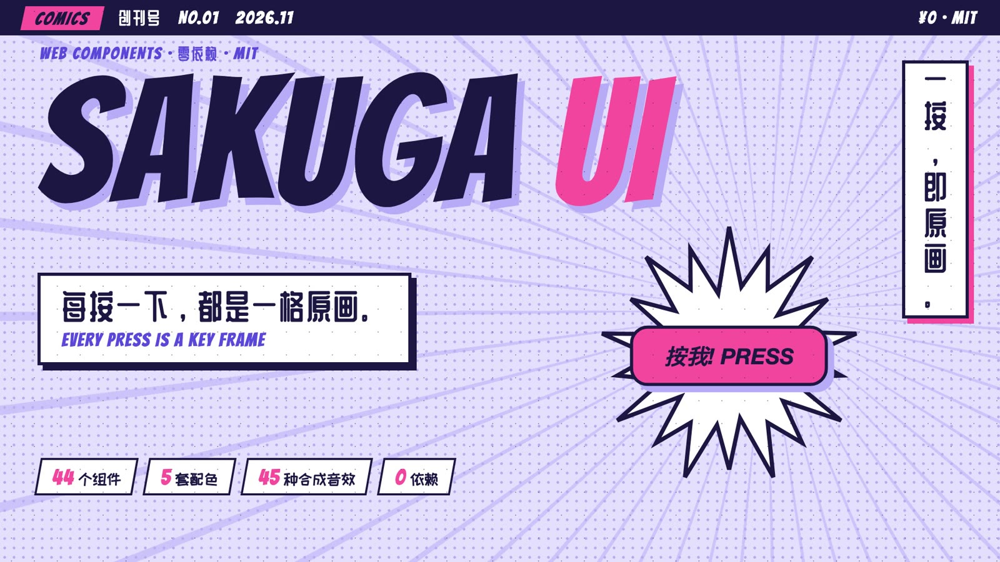
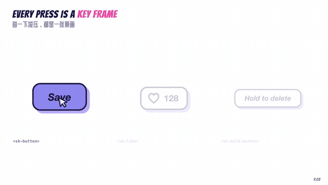
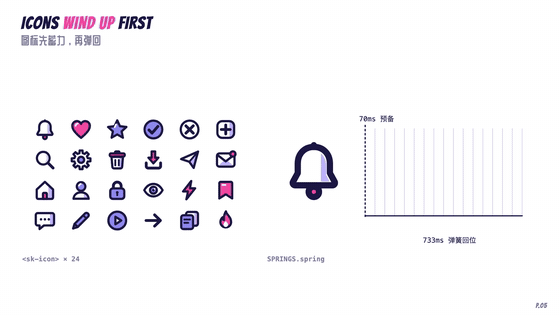
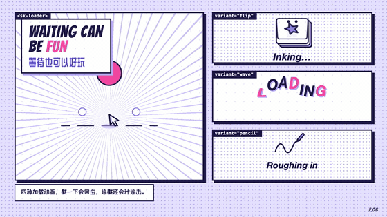
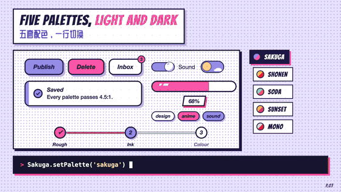
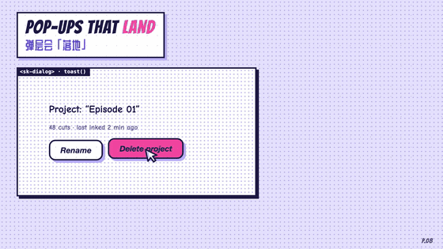

<div align="center">

<a href="docs/media/promo.mp4"></a>

<p><b>每按一下，都是一格原画。</b><br>
带原画力道的 Web Components 组件库：赛璐璐特效、片假名拟声词、实时合成的音效，共用一个小内核。</p>

<p>
<a href="https://github.com/LeeHongji/sakuga-ui/blob/main/LICENSE"></a>
<a href="https://www.npmjs.com/package/sakuga-ui"></a>


</p>

<p>
<a href="https://leehongji.github.io/sakuga-ui/"><b>文档站</b></a> ·
<a href="docs/media/promo.mp4"><b>宣传片（有声）</b></a> ·
<a href="#快速上手"><b>快速上手</b></a> ·
<a href="README.en.md"><b>English</b></a>
</p>

</div>

---

## 第 0 话 · 先看一眼

<table>
<tr>
<td width="50%"><br><b>按压是原画。</b> 按钮压扁再弹回，点赞炸开，长按蓄满力才「ザンッ!」地斩开。</td>
<td width="50%"><br><b>拟声词是字幕。</b> <code>sfx('ドン!')</code> 一行，十种声线，每个词自带字体、描边、入场和声音。</td>
</tr>
<tr>
<td><br><b>图标先蓄力。</b> 24 个手绘图标，先用 70 毫秒压进预备姿势，再沿同一条弹簧曲线弹回。</td>
<td><br><b>等待也好玩。</b> 四种加载动画，戳一下会回应，连戳还会计连击。</td>
</tr>
<tr>
<td><br><b>五套配色，一行切换。</b> <code>setPalette('soda')</code>，每套都有明暗两种，正文对比度都不低于 4.5:1。</td>
<td><br><b>弹层会落地。</b> 对话框、通知、特效都在浏览器顶层，不怕 <code>overflow</code> 和 <code>z-index</code>。</td>
</tr>
</table>

上面的动图都截自宣传片。宣传片里的每个组件都是这个库本身，每次点击都是真实的鼠标事件，声音也是组件当场合成的。

## 特点

- **63 个 `sk-*` 标签**：操作、表单、反馈、浮层、导航、展示、漫画技法七类，外加 24 个动效图标和 4 种趣味加载
- **零依赖**：原生自定义元素，React / Vue / Svelte / 纯 HTML 都直接写标签
- **一个内核**：所有组件共用一套特效图元、一套拟声词排版规则、一套音效配方（45 种，WebAudio 合成，没有音频文件）
- **真实的弹簧**：解一次，烘焙成 CSS `linear()` 缓动，交给合成层执行
- **顶层渲染**：弹窗、特效、拟声词通过 Popover API 放进浏览器顶层
- **克制**：特效分全 / 轻 / 关三档，音效可关，系统开启「减少动态效果」时自动关闭特效
- **体积**：全部组件 71 kB gzip，只用内核 20 kB gzip

> **状态**：0.1.0，已发布到 [npm](https://www.npmjs.com/package/sakuga-ui)。目前只在 Chromium 上做过完整验证。

## 快速上手

**安装**

```bash
npm i sakuga-ui
```

```js
import 'sakuga-ui';                          // 注册全部组件
import 'sakuga-ui/components/forms.js';      // 或者只要一组
import { configure, toast, setTheme, setPalette } from 'sakuga-ui';
```

**不用构建工具**

```html
<script type="module" src="https://cdn.jsdelivr.net/npm/sakuga-ui@0.1/dist/sakuga.js"></script>

<sk-button fx="boom">Confirm</sk-button>
<sk-switch checked>Wi-Fi</sk-switch>
<sk-progress value="40"></sk-progress>
```

`dist/sakuga.iife.js` 是全局变量版（`window.Sakuga`），可以用普通 `<script>` 引入。

```js
configure({ fx: 'lite', fps: 30, sound: true, volume: 0.5 });
toast('Saved!');
setTheme('dark');
setPalette('shonen');
```

带 TypeScript 类型（`types/index.d.ts`），`document.querySelector('sk-dialog')` 会得到 `SkDialog`。

## 组件

| 分组 | 标签 |
|---|---|
| 操作 | `sk-button` `sk-hold-button` `sk-like` `sk-segmented` `sk-copy` |
| 表单 | `sk-switch` `sk-theme-switch` `sk-checkbox` `sk-radio-group` `sk-radio` `sk-slider` `sk-input` `sk-textarea` `sk-select` `sk-stepper` `sk-rating` `sk-otp` |
| 反馈 | `sk-toast` `sk-alert` `sk-progress` `sk-ring` `sk-spinner` `sk-loader` `sk-skeleton` `sk-badge` `sk-tag` |
| 浮层 | `sk-dialog` `sk-drawer` `sk-tooltip` `sk-popover` `sk-menu` `sk-menu-item` |
| 导航 | `sk-tabs` `sk-tab` `sk-accordion` `sk-accordion-item` `sk-breadcrumb` `sk-pagination` `sk-steps` `sk-step` |
| 展示 | `sk-card` `sk-avatar` `sk-divider` `sk-kbd` `sk-bubble` `sk-counter` `sk-calendar` `sk-word` `sk-icon` |
| 漫画技法 | `sk-koma` `sk-koma-panel` `sk-pages` `sk-page` `sk-balloon-input` `sk-speedbar` `sk-flash` `sk-tone` `sk-hatch` `sk-yonkoma` `sk-koma-step` `sk-breakout` `sk-reactions` `sk-reaction` |

表单类组件（开关、复选框、单选、滑块、输入框、下拉、步进器、评分、验证码、日历）通过 `ElementInternals` 参与原生 `<form>` 提交。每个组件的属性、事件和方法见[文档站](https://leehongji.github.io/sakuga-ui/)对应的分格。

## 配置

```js
configure({
  fx: 'full',         // 'full' | 'lite' | 'off'：每次交互生成多少特效
  fps: 60,            // 60 | 30 | 24 | 12：特效帧率。60 跟随屏幕，30 是均匀的一拍二，12 是故意的卡顿感
  sound: true,
  volume: 0.5,
  lettering: true,    // 片假名拟声词
  fonts: 'google',    // 'system' 则不请求网络字体，只用系统字体
  maxParticles: 240,  // 活动粒子上限
  maxWords: 12,       // 同屏拟声词上限
  adaptive: true,     // 帧率低时自动减少粒子
});
```

单个按钮可以用 `fx` 属性单独调：`tap`（默认，轻微按压反馈）、`boom`（完整的「ドン!」）、`none`。操作成功后调用按钮的 `done()` 会画出对勾并停留；`success()` 是带一次冲击的版本，用于结束加载状态。

## 主题与配色

外观全部来自 `--sk-*` 变量，默认值在引入时注入到 `<head>` 最前面，你的样式表可以直接覆盖：

```css
:root {
  --sk-pink: #ff7a59;
  --sk-r: 8px;      /* 圆角 */
  --sk-bw: 2px;     /* 描边粗细 */
  --sk-sh: 4px;     /* 硬投影偏移 */
}
```

在任意祖先上加 `data-sk-theme="dark"` 切到暗色；`setTheme('dark', { x, y })` 会从给定位置做圆形擦除。

| 配色 | 样子 |
|---|---|
| `sakuga` | 默认。墨紫、长春花蓝、亮粉 |
| `shonen` | 暖白纸上的红与黄，周刊少年杂志的感觉 |
| `soda` | 薄荷绿配珊瑚红 |
| `sunset` | 晚霞橙配靛蓝墨 |
| `mono` | 黑白漫画页，只留一点红 |

```js
setPalette('shonen');   // 整页换色：组件、特效、拟声词一起换
```

也可以直接写 `<html data-sk-palette="soda">`。切换时 `document` 上会派发 `sk-palettechange`。每套配色里，正文、主色块上的字、亮色块上的字（`--sk-on-hot`）和次要文字（`--sk-muted`）的对比度都不低于 4.5:1，改色后用 `npm run contrast` 重算。

## 图标与加载

`<sk-icon name="bell">`：粗墨线、平涂、一块阴影、一点亮色。每个图标都有会动的零件（铃铛会摆、垃圾桶盖会掀、对话气泡的点会依次跳），悬停、点击或调用 `play()` 时播放。放在按钮里时，悬停按钮就会播放。

```html
<sk-icon name="heart" size="40"></sk-icon>
<sk-button><sk-icon name="download"></sk-icon>Download</sk-button>
<sk-button variant="solid"><sk-icon name="send" plain></sk-icon>Send</sk-button>
```

现有 24 个：`bell` `heart` `star` `check` `x` `plus` `search` `gear` `trash` `download` `send` `mail` `home` `user` `lock` `eye` `bolt` `bookmark` `chat` `pencil` `play` `arrow` `copy` `flame`。

`<sk-loader>` 把等待画成四种动画练习，全部是纯 CSS 循环：

| `variant` | 画的是什么 |
|---|---|
| `ball`（默认） | 弹跳球：挤压、拉伸、落地的小烟 |
| `flip` | 打了定位孔的动画纸，一拍二地翻 |
| `wave` | 文字本身，一个字一个字地跳（`text` 属性） |
| `pencil` | 铅笔打草稿，画完再来；`tips="画草稿|清线|上色"` 让提示语轮换 |

## 弹簧

四条预设曲线，既是 CSS 变量也是 JS 预设：

| 预设 | 变量 | 手感 |
|---|---|---|
| `spring` | `--sk-spring` / `--sk-spring-t` | 一次明显的过冲，默认 |
| `bounce` | `--sk-bounce` / `--sk-bounce-t` | 弹几下，用于按压和弹出 |
| `soft` | `--sk-soft` / `--sk-soft-t` | 轻微过冲，用于大面积元素 |
| `snap` | `--sk-snap` / `--sk-snap-t` | 又快又紧，用于小指示块 |

```css
.my-thing { transition: translate var(--sk-spring-t) var(--sk-spring); }
```

```js
import { spring } from 'sakuga-ui';
spring(el, [{ scale: 0.4 }, { scale: 1 }], 'bounce');
```

## 层级

对话框、抽屉、下拉、气泡卡片、菜单、文字提示、轻提示，以及特效画布和拟声词，都通过 Popover API 放进浏览器的顶层（top layer）：放进带 `overflow: hidden`、`transform` 或任意 `z-index` 的容器里也不会被裁掉；从对话框里触发的特效和轻提示画在对话框之上；下拉和气泡会翻到有空间的一侧。自己的浮层可以用同一套：`lift(el)`、`lower(el)`、`anchor(popup, trigger, { side, align })`。

## 性能

空闲时没有动画循环；画布、音频上下文、字体都在第一次用到时才创建。活动粒子最多 240 个，同屏拟声词最多 12 个；帧时间变长时自动减少粒子。每种组件一份可构造样式表，实例之间共享。

实测（Playwright 无头 Chromium，Apple M5，1440×900，2026-11-18；各次运行之间有波动）：

| 场景 | 结果 |
|---|---|
| 空闲 3 秒，页面上 288 个组件实例 | `requestAnimationFrame` 0 次，画布 0 个，未创建音频上下文 |
| 一次「ドン!」按钮 / 大号开关 / 复选框 / 拖动滑块 | 约 120 fps，最慢一帧 10–18 ms |
| 压力测试：3 秒内 180 次爆炸 | 平均 75–101 fps |
| 同样的压力测试，CPU 限速到 1/4 | 平均 27–40 fps，粒子自动降到 35% |
| 一次性创建 400 个组件 | 16–26 ms |

## 自己写组件

```
src/core/         内核，所有组件共用
  fx.js           特效引擎：两层画布、粒子图元、上限和自动降级
  lettering.js    拟声词：十种声线，逐字排版
  sound.js        WebAudio 合成音效，45 个配方
  layer.js        顶层：lift / lower / anchor
  spring.js       弹簧曲线：解一次，烘焙成 CSS linear()
  motion.js       挤压拉伸预设与 spring()
  moves.js        组合动作（tap / impact / boom / poof / cut …）
  element.js      SkElement 基类：共享样式表、声明式属性、表单参与
  tokens.js       设计变量；palettes.js 五套配色
src/components/   七组组件，外加 icons.js 和 loaders.js
types/            TypeScript 声明
site/ index.html  文档站（漫画杂志）
```

继承 `SkElement`，调用 `moves.*`，效果就和库里的一致。给可按的元素加 `press` 或 `lift` 类就有按压回弹。

## 开发

```bash
npm install        # 只有 esbuild
npm run docs       # 文档站，http://localhost:8823，直接加载 src/，不需要构建
npm run build      # 打包到 dist/，写入 dist/meta.json
npm test           # 三种语言、两种主题、三种配置下把文档站的演示全部点一遍
npm run audit      # 显示审查：5 种窗口宽度 × 3 种语言，查遮挡、溢出、被裁切的拟声词
npm run padding    # 内边距审查：在 4 倍像素上量内容到四边的距离
npm run contrast   # 10 种配色组合 × 9 种文字角色的对比度
npm run perf       # 性能测量，写入 site/measured.json
```

除 `build` 外都需要 Python 的 Playwright，并且文档站在 8823 端口运行。`_tools/capture.py` 用虚拟时钟逐帧录制交互（计时器、`requestAnimationFrame`、Web Animations、CSS 过渡都按 1/60 秒步进），宣传片也是用同样的方法录的。改了 `src/` 记得 `npm run build` 并提交 `dist/`，CI 会检查两者一致。

## 浏览器

用到了可构造样式表、`ElementInternals`、`roundRect`、`color-mix()` 和独立的 `translate` / `scale` 属性，对应 Chrome / Edge 111+、Safari 16.4+、Firefox 113+。没有 Popover API 时退回固定定位加最高 `z-index`，没有 `linear()` 缓动时退回带过冲的贝塞尔曲线。目前只在 Chromium 上实际验证过。

## 致谢

视觉语言复刻并扩展自 FinkTheArtist 的 “Sakuga UI set” 演示视频。字体来自 Google Fonts：Bangers、Comic Neue、ZCOOL QingKe HuangYou、ZCOOL KuaiLe、Chokokutai、Reggae One、Dela Gothic One、Mochiy Pop One、Potta One、Stick。

[MIT](LICENSE)
